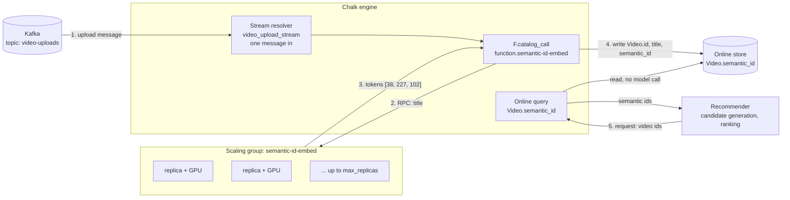

# Calling the semantic-ID model from Chalk

[`calling_from_chalk.py`](calling_from_chalk.py) shows the three ways Chalk reaches the model that
[`src/deploy_function.py`](../src/deploy_function.py) deploys. All three name it the same way,
`function.semantic-id-embed`: `function.` plus the deploy `--name`, not the Python function's name.

| Example | Call | Run |
| --- | --- | --- |
| Chalk SQL | `catalog_call('function.semantic-id-embed', title)` | `python calling_from_chalk.py sql` |
| chalkdf | `F.catalog_call(...)` inside `with_columns`, then `run(remote=True)` | `python calling_from_chalk.py chalkdf` |
| Stream resolver | `F.catalog_call(...)` in `make_stream_resolver`'s `output_features` | `python calling_from_chalk.py stream` |
| Expression feature | `Video.semantic_id_on_read = F.catalog_call(...)`, computed at query time | `chalk query --branch semantic-ids --in video.id=1 --in "video.title=..." --out video.semantic_id_on_read` |

```bash
cd examples
chalk apply --branch semantic-ids                       # deploys Video and the stream resolver on a branch
export CHALK_ENVIRONMENT=<env id>
python calling_from_chalk.py sql
python calling_from_chalk.py chalkdf
python calling_from_chalk.py stream                     # test_streaming_resolver: no Kafka cluster needed
```

## Before the first call

The engine reads the function catalog when it deploys, so a function deployed after the engine's last deploy
is invisible to it (`Service '...' is not configured`). Redeploy the engine, or re-activate its current
deployment, then check that the function is listed:

```bash
chalk deployment activate --deployment <latest SUCCESS deployment id>
chalk sql "select function_name, qualified_name, output_type from chalk.information_schema.compute_functions"
```

## From upload to recommendation



1. **Kafka.** An upload event lands on `video-uploads`.
2. **Stream resolver.** `video_upload_stream` maps each message to `Video` features. Its `semantic_id`
   output is an `F.catalog_call`, so the engine calls the deployed function once per message.
3. **Scaling group.** The call goes over RPC to the function's replicas, which return the tokens. The
   replica count follows load between `min_replicas` and `max_replicas`, with the GPU set by `gpu` in
   `chalkcompute.function`:

   ```python
   chalkcompute.function(
       image=image,
       name="semantic-id-embed",
       gpu="nvidia-l4",                       # "<type>" or "<count>:<type>", e.g. "2:nvidia-a100"
       min_replicas=1,
       max_replicas=8,
       target_gpu_utilization_percentage=70,  # scale on DCGM GPU utilization (needs min_replicas >= 1)
       # target_queue_depth=16,               # or scale on the function's own pending-request queue
   )
   ```

   `src/deploy_function.py` currently deploys a CPU replica (`--cpu`, `--memory`), one title per call.
   For a sustained stream, `max_batching_size` and `max_buffer_duration` let one GPU call encode many
   titles at once. With batching enabled the handler receives lists, so the function would take
   `list[str]` and return a list of token lists.
4. **Online store.** The resolver writes `Video.id`, `title` and `semantic_id` together. The model runs once
   per video, at ingest.
5. **Serving.** A recommendation request is an online query for `Video.semantic_id` over candidate video
   ids. It reads the stored tokens and never touches the GPU. A video that never came through the stream
   can still get an ID at request time from the `semantic_id_on_read` expression feature, which calls the
   function on read.

## Notes

- **chalkdf `output_type`.** A plain script has no catalog to look the output type up in, so
  `F.catalog_call` needs `output_type=pa.large_list(pa.int64())` there. Inside a resolver it can be left out.
- **Stream test message bodies.** Pass them to `test_streaming_resolver` as JSON text
  (`model.model_dump_json()`). Pydantic objects are sent as a JSON string, and every message fails with
  `json_to_struct_strict: Expected JSON object at root`.
- **Branch runtime.** A branch must run the same Python runtime as the environment's main deployment.
  `chalk.yml` says `python311`; change it to match your environment.
- **Placeholder Kafka source.** The `KafkaSource` bootstrap server and topic are placeholders. Point them at
  your cluster before deploying the resolver to the environment's main deployment.
