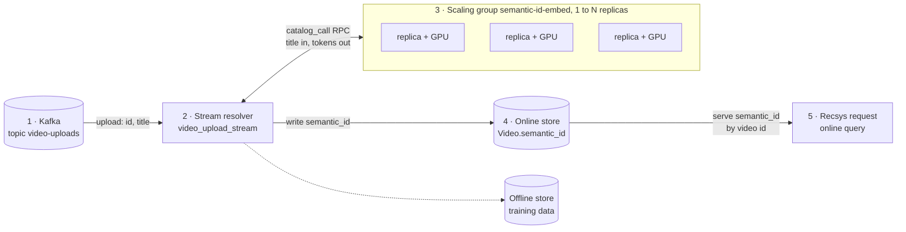

# Calling the semantic-ID model from Chalk

[`semantic_ids_in_chalk.py`](semantic_ids_in_chalk.py) calls the function that
`src/deploy_function.py` deploys, from each place Chalk can call it. Inside Chalk the
function is named `function.semantic-id-embed`: `function.` plus the deploy's `--name`,
not the Python function's name.

| Where | How | Run |
| --- | --- | --- |
| Chalk SQL | `catalog_call('function.semantic-id-embed', title)` | `python semantic_ids_in_chalk.py sql` |
| chalkdf | `F.catalog_call(...)` in `with_columns`, executed with `run(remote=True)` | `python semantic_ids_in_chalk.py chalkdf` |
| Stream resolver | `F.catalog_call(...)` in `make_stream_resolver`'s `output_features` | `python semantic_ids_in_chalk.py stream` |
| Online query | an expression feature, `F.catalog_call(...)` as the feature's default | `python semantic_ids_in_chalk.py query` |

## From an upload to a recommendation



1. **Kafka.** Each new video is a message on the `video-uploads` topic: an id and a
   title. The video has no watch history yet.
2. **Stream resolver.** `video_upload_stream` parses each message into `VideoUploaded`
   and maps it onto `Video` features. One mapping is
   `F.catalog_call("function.semantic-id-embed", _.title)`.
3. **Scaling group.** That call is an RPC to the function's scaling group. The group
   adds and removes replicas between its minimum and maximum, so upload bursts scale it
   out and quiet periods scale it in. Each replica runs the title encoder and quantizer
   and returns three tokens.
4. **Online store.** The resolver writes `id`, `title` and `semantic_id` to the online
   store, and to the offline store for training. The model runs once per upload.
5. **Recsys request.** A recommendation request reads `Video.semantic_id` from the
   online store by video id, for a candidate or for each video in a user's history. The
   request never waits on the model. A brand-new video is addressable as soon as its
   upload message has been processed.

For titles that never came through the stream, `Video.semantic_id_on_read` computes the
same tokens at query time: steps 3 and 5 in one request.

### Running the model on GPUs

`src/deploy_function.py` deploys the model on CPU, one replica, and a warm call takes
about 100ms round trip. To put the replicas in step 3 on GPUs and let the group
scale them, pass these to `chalkcompute.function`:

```python
chalkcompute.function(
    image=image,
    name="semantic-id-embed",
    gpu="nvidia-l4",
    cpu="4",
    memory="16Gi",
    min_replicas=1,
    max_replicas=8,
    # Scale out when the replicas' average GPU utilization passes 70%.
    target_gpu_utilization_percentage=70,
)
```

`target_gpu_utilization_percentage` needs `min_replicas` of at least 1: the
utilization series only exists while a replica does, so it cannot scale a group up from
zero. On GPU, the encoder in `semantic_id_for_title` must be created with
`device="cuda"` instead of `device="cpu"`.

## Running the examples

```bash
cd examples
uv venv -p 3.11 && uv pip install -r requirements.txt polars pyarrow pandas
export CHALK_ENVIRONMENT=<env id>
chalk apply --branch semantic-ids-examples   # deploys Video and the stream resolver
python semantic_ids_in_chalk.py sql
python semantic_ids_in_chalk.py stream
python semantic_ids_in_chalk.py query
```

`chalkdf` is installed separately (`pip install chalkdf`). The `chalkdf` example runs
as a job in the environment, which takes a few minutes to start.

The engine reads its function catalog when it deploys. If the function was deployed
after the engine, redeploy the engine, or re-activate its current deployment, before
calling it:

```bash
chalk deployment activate --deployment <latest SUCCESS id from `chalk deployment list`>
```

`chalk.yml` says `python311` because a branch must run the same Python runtime as the
environment's main deployment. Change it to match yours.

## What was run

On the staging `oracle-gpu` environment, against the CPU deployment of
`semantic-id-embed`:

| Example | Result |
| --- | --- |
| `sql` | `[38, 227, 102]`, `[0, 32, 225]`, `[220, 147, 250]` for the three titles |
| `stream` | the same three IDs, from three messages fed to the resolver on a branch |
| `query` | `[38, 227, 102]` for the first title, from `semantic_id_on_read` |
| `chalkdf` | the same IDs, from a job in the environment |

The GPU configuration above was not deployed. Steps 1, 4 and 5 were not run end to end
here. The `stream` example feeds messages straight to the resolver, so no Kafka cluster
was involved. Branches in this environment have no online store, so the write in step 4
and the read in step 5 happen only on the environment's main deployment.
